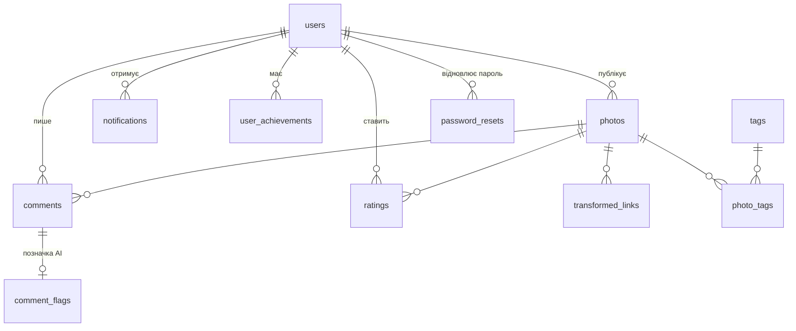

# Модель даних

PostgreSQL 17 через Prisma. Схема - [backend/prisma/schema.prisma](../backend/prisma/schema.prisma), зміни - лише міграціями в `backend/prisma/migrations`.

## Схема

## Таблиці

| Таблиця | Що зберігає | Головне |
|---|---|---|
| `users` | акаунти | унікальні `username`, `email`, `google_id`; `password_hash` порожній лише в Google-акаунтів (CHECK: є пароль або Google); `role`, `is_active` (бан) |
| `photos` | світлини | `slug` (12 символів, для посилань), `url` і `public_id` Cloudinary, `description` до 1000, `colors` і `color_families` (палітра) |
| `tags`, `photo_tags` | теги і зв'язок зі світлинами | `tags.name` унікальне, до 30 символів, малими літерами |
| `comments` | коментарі | `text` до 1000, `created_at`, `updated_at` |
| `ratings` | оцінки 1-5 | унікальна пара (світлина, користувач) - одна оцінка на людину |
| `transformed_links` | QR-посилання на трансформовані версії | `url`, `qr_code` (PNG data URL), `transformations` (JSON) |
| `notifications` | сповіщення | тип, хто зробив, світлина, `data` (JSON), `read_at` |
| `user_achievements` | отримані досягнення | унікальна пара (користувач, код) |
| `comment_flags` | позначки AI-модерації | категорія, пояснення, `dismissed_at`; окремо від коментаря, щоб не змінювати його `updated_at` |
| `password_resets` | посилання для відновлення пароля | лише SHA-256 токена, `expires_at` (1 година), `used_at` - одноразове |
| `token_blacklist` | токени після виходу | `jti`, `expires_at`; прострочені записи чистяться щогодини |

## Правила

- **Імена** - `snake_case` у базі, `camelCase` у Prisma через `@map`; ключі `SERIAL`; час - `timestamp(3)`.
- **Каскад** лише від світлини та коментаря до їхніх дочірніх записів: видалення світлини прибирає коментарі, оцінки, теги-зв'язки, посилання, сповіщення і позначки.
- **Користувачів не видаляємо**, лише банимо: світлини, коментарі й оцінки пов'язані з `users` без каскаду, тож випадкове видалення користувача не зітре контент.

## Індекси

| Для чого | Індекс |
|---|---|
| стрічка і профіль | `photos (created_at DESC, id DESC)`, `photos (author_id, created_at DESC)` |
| пошук за текстом | GIN trigram на `photos.description`, `tags.name`, `users.name`, `users.email` |
| пошук за кольором | GIN на `photos.color_families` |
| рейтинг і сортування за ним | `ratings (photo_id, value)` |
| коментарі світлини | `comments (photo_id, created_at DESC, id DESC)` |
| сповіщення і лічильник непрочитаних | `notifications (user_id, created_at DESC, id DESC)`, `(user_id, read_at)` |
| черга модерації | `comment_flags (dismissed_at, created_at DESC)` |
