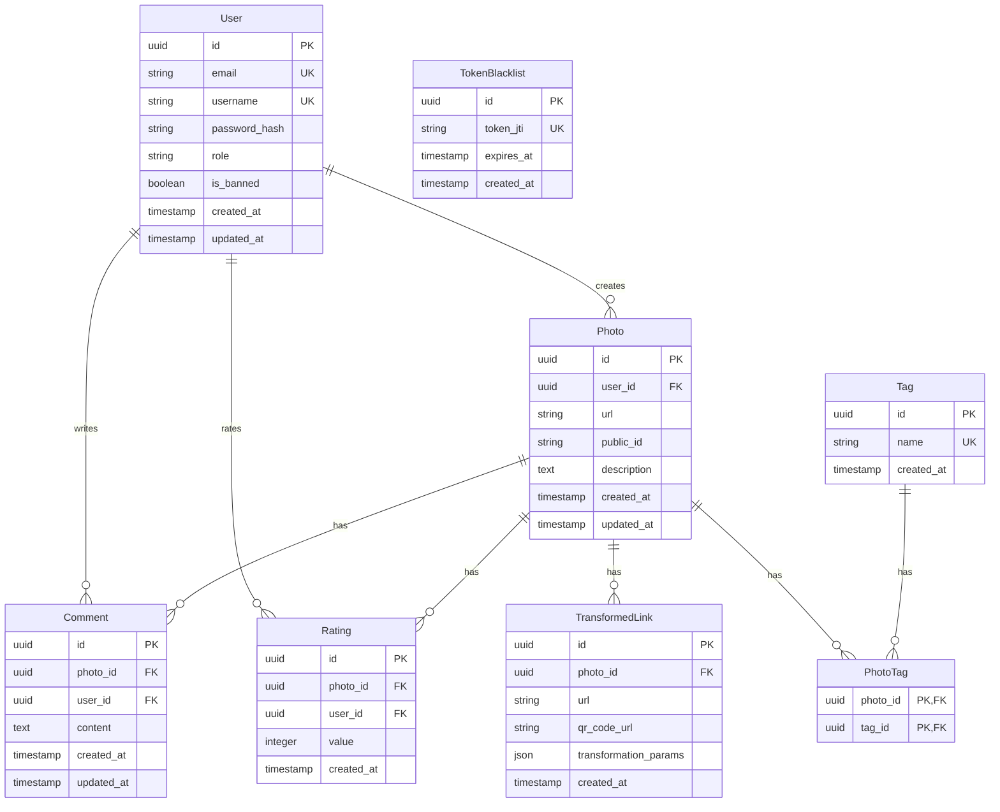

# Модель даних (Data Model) — PhotoShare

Документ описує структуру бази даних PostgreSQL для проєкту PhotoShare: таблиці, поля, типи даних, обмеження, зв'язки, індекси та ER-діаграму.

## ER-діаграма (Mermaid)

## Опис таблиць

| Таблиця | Призначення | Основні поля |
|---|---|---|
| `users` | Облікові записи користувачів | `id`, `email`, `username`, `password_hash`, `role`, `is_banned`, `created_at`, `updated_at` |
| `photos` | Опубліковані світлини | `id`, `user_id`, `url`, `public_id`, `description`, `created_at`, `updated_at` |
| `tags` | Теги для категоризації світлин | `id`, `name`, `created_at` |
| `photo_tags` | Зв'язок між світлинами й тегами | `photo_id`, `tag_id` |
| `comments` | Коментарі до світлин | `id`, `photo_id`, `user_id`, `content`, `created_at`, `updated_at` |
| `ratings` | Оцінки світлин | `id`, `photo_id`, `user_id`, `value`, `created_at` |
| `transformed_links` | Посилання на перетворені світлини | `id`, `photo_id`, `url`, `qr_code_url`, `transformation_params`, `created_at` |
| `token_blacklist` | Недійсні токени автентифікації | `id`, `token_jti`, `expires_at`, `created_at` |

## Типи даних та обмеження

- Ідентифікатори сутностей — `UUID`, первинні ключі — `PRIMARY KEY`.
- `users.email` і `users.username` мають бути унікальними (`UNIQUE`) та обов'язковими (`NOT NULL`).
- `tags.name` має бути унікальним (`UNIQUE`) та обов'язковим (`NOT NULL`).
- `token_blacklist.token_jti` має бути унікальним.
- Зовнішні ключі (`FOREIGN KEY`) забезпечують цілісність зв'язків між таблицями.
- `photo_tags` використовує складений первинний ключ (`photo_id`, `tag_id`), щоб не допустити дублювання одного й того самого тегу для світлини.
- `comments.created_at` зберігає час створення коментаря, а `comments.updated_at` — час останнього оновлення.
- `ratings.value` має бути цілим числом. Допустимий діапазон значень необхідно визначити відповідно до вимог продукту.
- Для часових полів PostgreSQL рекомендується використовувати `TIMESTAMPTZ`.

## Зв'язки між таблицями

- Один користувач може створити багато світлин: `users` → `photos` (one-to-many).
- Одна світлина може мати багато коментарів: `photos` → `comments` (one-to-many).
- Один користувач може залишати багато коментарів: `users` → `comments` (one-to-many).
- Світлини й теги мають зв'язок many-to-many через проміжну таблицю `photo_tags`.
- Одна світлина може мати багато оцінок і перетворених посилань.
- Кожна оцінка належить одному користувачу й одній світлині.

## Індекси

Рекомендовані індекси для пошуку та фільтрації:

- `users.email` — унікальний індекс для пошуку користувача за email.
- `users.username` — унікальний індекс для пошуку за username.
- `tags.name` — унікальний індекс для пошуку тегу за назвою.
- `photos.user_id` — пошук світлин конкретного користувача.
- `photos.created_at` — сортування світлин за датою створення.
- `comments.photo_id` — отримання коментарів до світлини.
- `comments.user_id` — пошук коментарів користувача.
- `ratings.photo_id` — отримання оцінок світлини.
- `photo_tags.tag_id` — пошук світлин за тегом.
- `token_blacklist.expires_at` — пошук токенів, термін дії яких минув.

Унікальні обмеження зазвичай автоматично створюють індекси в PostgreSQL. Індекси для зовнішніх ключів слід перевірити та за потреби додати окремо.

## Примітка

Описані поля, типи даних і зв'язки потрібно звірити з наявною Prisma-схемою та іншою документацією PhotoShare перед затвердженням змін.
