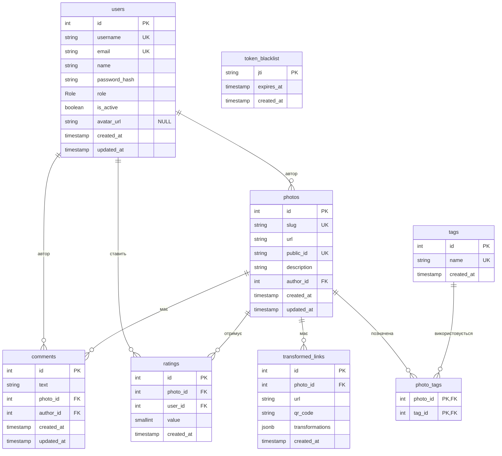

# Модель даних

СУБД: PostgreSQL 17, доступ через Prisma. Зараз у міграції `20261014000000_init` є лише `users` (рішення [D-10](DECISIONS.md)). Решту таблиць з цього документа створює TASK-009 окремою міграцією, тому цей файл є специфікацією для неї.

Загальні правила:

- Імена таблиць і стовпців у `snake_case`, в Prisma через `@map`. Первинні ключі `SERIAL` (`Int @default(autoincrement())`), як у `users`.
- Час: `timestamp(3)`, як у першій міграції. `created_at` ставить БД (`DEFAULT CURRENT_TIMESTAMP`), `updated_at` оновлює Prisma (`@updatedAt`).
- `onDelete: Cascade` скрізь, де дочірній запис не має сенсу без батьківського. Видалення світлини прибирає її коментарі, оцінки, посилання і зв'язки з тегами (вимога API: "Коментарі видаляються разом зі світлиною").

## ER-діаграма

`token_blacklist` ні з чим не зв'язана навмисно: `jti` це ідентифікатор JWT, а не ключ користувача.

## Таблиці

Скорочення: PK первинний ключ, FK зовнішній, UQ унікальний, NN `NOT NULL`.

### users

Існує в міграції `init`. Додається один стовпець `avatar_url` (API віддає `avatarUrl`, зараз сервер завжди повертає `null`).

| Стовпець | Тип | Обмеження | Опис |
|---|---|---|---|
| id | serial | PK | |
| username | text | NN, UQ | 3-30 символів `[a-zA-Z0-9_.-]` (перевіряє zod) |
| email | text | NN, UQ | у нижньому регістрі (нормалізує сервер) |
| name | text | NN | 1-60 символів, за замовчуванням = `username` |
| password_hash | text | NN | bcrypt |
| role | enum `Role` | NN, default `USER` | `USER`, `MODERATOR`, `ADMIN` |
| is_active | boolean | NN, default `true` | `false` = забанений |
| avatar_url | text | NULL | нова колонка |
| created_at | timestamp(3) | NN, default now | |
| updated_at | timestamp(3) | NN | |

### photos

| Стовпець | Тип | Обмеження | Опис |
|---|---|---|---|
| id | serial | PK | |
| slug | varchar(12) | NN, UQ | унікальне посилання на світлину, [D-14](DECISIONS.md) |
| url | text | NN | URL оригіналу в Cloudinary |
| public_id | text | NN, UQ | id у Cloudinary, потрібен для видалення файлу |
| description | varchar(1000) | NN | 1-1000 символів |
| author_id | int | NN, FK `users.id`, ON DELETE CASCADE | |
| created_at | timestamp(3) | NN, default now | дата додавання, за нею стрічка і фільтр `dateFrom/dateTo` |
| updated_at | timestamp(3) | NN | |

### tags

| Стовпець | Тип | Обмеження | Опис |
|---|---|---|---|
| id | serial | PK | |
| name | varchar(30) | NN, UQ, CHECK `name = lower(name)` | унікальний у всьому застосунку, нижній регістр ([D-09](DECISIONS.md)) |
| created_at | timestamp(3) | NN, default now | |

Теги не видаляються разом зі світлинами: невикористаний тег лишається і його можна перевикористати. Якщо таких стане багато, їх можна чистити окремою задачею.

### photo_tags

Зв'язна таблиця для many-to-many `photos` - `tags`.

| Стовпець | Тип | Обмеження |
|---|---|---|
| photo_id | int | PK (частина), FK `photos.id`, ON DELETE CASCADE |
| tag_id | int | PK (частина), FK `tags.id`, ON DELETE CASCADE |

Складений PK `(photo_id, tag_id)` не дає додати той самий тег до світлини двічі. Ліміт "не більше 5 тегів на світлину" в БД не виражається простим обмеженням, його перевіряє сервіс (шостий тег: 422).

### comments

| Стовпець | Тип | Обмеження | Опис |
|---|---|---|---|
| id | serial | PK | |
| text | varchar(1000) | NN | 1-1000 символів після обрізання пробілів |
| photo_id | int | NN, FK `photos.id`, ON DELETE CASCADE | |
| author_id | int | NN, FK `users.id`, ON DELETE CASCADE | |
| created_at | timestamp(3) | NN, default now | час створення |
| updated_at | timestamp(3) | NN | час останньої зміни; Prisma ставить його при створенні і оновлює при кожному `PUT` |

`created_at` не змінюється ніколи. Фронтенд показує "(ред.)", коли `updated_at` пізніше за `created_at`.

### transformed_links

Збережені посилання на трансформовані зображення з QR-кодом (TASK-030). Кожен `POST /api/photos/:id/links` створює новий рядок.

| Стовпець | Тип | Обмеження | Опис |
|---|---|---|---|
| id | serial | PK | |
| photo_id | int | NN, FK `photos.id`, ON DELETE CASCADE | |
| url | text | NN | URL трансформованого зображення в Cloudinary |
| qr_code | text | NN | PNG у форматі data URL |
| transformations | jsonb | NN | `{ effect?, angle?, crop? }`, [D-08](DECISIONS.md) |
| created_at | timestamp(3) | NN, default now | |

### ratings

| Стовпець | Тип | Обмеження | Опис |
|---|---|---|---|
| id | serial | PK | |
| photo_id | int | NN, FK `photos.id`, ON DELETE CASCADE | |
| user_id | int | NN, FK `users.id`, ON DELETE CASCADE | |
| value | smallint | NN, CHECK `value BETWEEN 1 AND 5` | |
| created_at | timestamp(3) | NN, default now | |

UQ `(photo_id, user_id)`: одна оцінка на користувача, повторна дає 409. Заборону оцінювати власну світлину (403) перевіряє сервіс. `averageRating` і `ratingsCount` рахуються агрегатом (`AVG`, `COUNT`), окремо не зберігаються, щоб не розходитися з даними.

### token_blacklist

Токени, які більше не приймаємо після виходу ([D-04](DECISIONS.md), [D-05](DECISIONS.md)). Використовується з Sprint-4.

| Стовпець | Тип | Обмеження | Опис |
|---|---|---|---|
| jti | varchar(36) | PK | унікальний номер токена (UUID з claim `jti`) |
| expires_at | timestamp(3) | NN | коли токен і так спливає |
| created_at | timestamp(3) | NN, default now | |

Рядок з `expires_at < now()` вже нічого не блокує, тому його можна безпечно видаляти періодичною чисткою.

## Зв'язки

| Зв'язок | Тип | Реалізація |
|---|---|---|
| users - photos | 1:N | `photos.author_id` |
| users - comments | 1:N | `comments.author_id` |
| users - ratings | 1:N | `ratings.user_id` |
| photos - comments | 1:N | `comments.photo_id`, ON DELETE CASCADE |
| photos - ratings | 1:N | `ratings.photo_id` |
| photos - transformed_links | 1:N | `transformed_links.photo_id` |
| photos - tags | M:N | через `photo_tags` |

## Індекси

Унікальні індекси створюються разом з UQ-обмеженнями: `users.username`, `users.email`, `photos.slug`, `photos.public_id`, `tags.name`, `ratings(photo_id, user_id)`, PK `photo_tags(photo_id, tag_id)`. Нижче додаткові індекси під конкретні запити.

| Індекс | Для чого |
|---|---|
| `photos(created_at DESC, id DESC)` | стрічка `GET /api/photos`, сортування пошуку за датою, фільтр `dateFrom/dateTo` |
| `photos(author_id, created_at DESC)` | світлини профілю, фільтр пошуку за `username` |
| `photos` GIN `description gin_trgm_ops` | пошук за ключовим словом `q` (`ILIKE '%...%'`); потрібне розширення `pg_trgm` (`CREATE EXTENSION IF NOT EXISTS pg_trgm`) |
| `tags` GIN `name gin_trgm_ops` | частковий збіг тега в `q` |
| `photo_tags(tag_id, photo_id)` | фільтр `tag`: від тега до світлин (PK покриває лише напрямок від світлини до тегів) |
| `comments(photo_id, created_at DESC, id DESC)` | список коментарів світлини зі сторінками, лічильник `commentsCount` |
| `comments(author_id)` | швидке каскадне видалення при видаленні користувача |
| `ratings(user_id)` | `myRating`, каскад при видаленні користувача (пошук за `photo_id` покриває UQ) |
| `transformed_links(photo_id)` | `GET /api/photos/:id/links` |
| `token_blacklist(expires_at)` | чистка прострочених токенів |
| `users(role)` | фільтр `role` в адмінці |
| `users(created_at)` | фільтр `registeredFrom/registeredTo` в адмінці |
| `users` GIN `name gin_trgm_ops`, `email gin_trgm_ops` | пошук `q` в адмінці (ім'я або email) |

Prisma не вміє описати GIN з `gin_trgm_ops` у схемі, тому ці індекси і розширення додаються вручну в SQL міграції TASK-009 (`prisma migrate dev --create-only`, потім правимо `migration.sql`). Решту індексів описуємо через `@@index`.

Фільтр `ratingMin` і сортування `sort=rating` працюють через `GROUP BY photo_id` + `AVG(value)` по `ratings`. Для навчального обсягу цього досить, окремого стовпця з кешем середнього не заводимо.

## Покриття вимог ТЗ

| Вимога | Де в моделі |
|---|---|
| Реєстрація, ролі, бан | `users` (`role`, `is_active`) |
| Вихід, недійсні токени | `token_blacklist` |
| Світлини з описом і унікальним посиланням | `photos` (`description`, `slug`) |
| До 5 тегів, унікальні теги | `tags`, `photo_tags` |
| Трансформації, QR | `transformed_links` |
| Коментарі з датою створення і редагування | `comments` (`created_at`, `updated_at`) |
| Рейтинг 1-5, одна оцінка | `ratings` |
| Пошук і фільтри (ключове слово, тег, дата, рейтинг, автор) | індекси вище |
| Адмінка: фільтри користувачів | `users` (`role`, `created_at`, `name`, `email`) |
