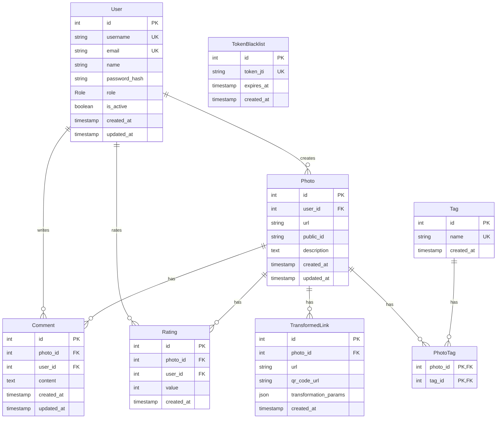

# Модель даних (Data Model) — PhotoShare

Документ описує проєктну структуру бази даних PostgreSQL для PhotoShare: таблиці, поля, типи даних, обмеження, зв’язки, індекси та ER-діаграму.

Модель охоплює сутності, визначені в TASK-004. Структуру `users` звірено з наявною Prisma-схемою. Інші сутності є проєктним описом і мають бути узгоджені з реалізацією перед застосуванням міграцій.

## ER-діаграма (Mermaid)

## Опис таблиць

### 1. `users` — користувачі

Зберігає облікові записи користувачів. Структуру звірено з наявною моделлю Prisma `User`.

| Поле | Тип | Обмеження |
|---|---|---|
| `id` | `SERIAL` / `Int` | Первинний ключ, автоінкремент |
| `username` | `TEXT` | `NOT NULL`, `UNIQUE` |
| `email` | `TEXT` | `NOT NULL`, `UNIQUE` |
| `name` | `TEXT` | `NOT NULL` |
| `password_hash` | `TEXT` | `NOT NULL` |
| `role` | `Role` | `NOT NULL`, за замовчуванням `USER` |
| `is_active` | `BOOLEAN` | `NOT NULL`, за замовчуванням `true` |
| `created_at` | `TIMESTAMP(3)` | `NOT NULL`, за замовчуванням поточний час |
| `updated_at` | `TIMESTAMP(3)` | `NOT NULL`, оновлюється Prisma |

Enum `Role` містить значення `USER`, `MODERATOR` та `ADMIN`.

### 2. `photos` — світлини

Зберігає опубліковані світлини та їхні метадані.

| Поле | Тип | Обмеження |
|---|---|---|
| `id` | `INTEGER` | Первинний ключ, автоінкремент |
| `user_id` | `INTEGER` | Зовнішній ключ на `users.id`, `NOT NULL` |
| `url` | `TEXT` | `NOT NULL` |
| `public_id` | `TEXT` | Ідентифікатор у сховищі; унікальність узгодити з вимогами сховища |
| `description` | `TEXT` | Необов’язковий опис |
| `created_at` | `TIMESTAMPTZ` | Час створення |
| `updated_at` | `TIMESTAMPTZ` | Час останнього оновлення |

### 3. `tags` — теги

Зберігає назви тегів для категоризації світлин.

| Поле | Тип | Обмеження |
|---|---|---|
| `id` | `INTEGER` | Первинний ключ, автоінкремент |
| `name` | `TEXT` | `NOT NULL`, `UNIQUE` |
| `created_at` | `TIMESTAMPTZ` | Час створення |

### 4. `photo_tags` — зв’язок світлин і тегів

Проміжна таблиця для зв’язку багато-до-багатьох між світлинами й тегами.

| Поле | Тип | Обмеження |
|---|---|---|
| `photo_id` | `INTEGER` | Зовнішній ключ на `photos.id` |
| `tag_id` | `INTEGER` | Зовнішній ключ на `tags.id` |

Складений первинний ключ `(photo_id, tag_id)` не дозволяє призначити той самий тег одній світлині повторно.

### 5. `comments` — коментарі

Зберігає коментарі користувачів до світлин.

| Поле | Тип | Обмеження |
|---|---|---|
| `id` | `INTEGER` | Первинний ключ, автоінкремент |
| `photo_id` | `INTEGER` | Зовнішній ключ на `photos.id`, `NOT NULL` |
| `user_id` | `INTEGER` | Зовнішній ключ на `users.id`, `NOT NULL` |
| `content` | `TEXT` | `NOT NULL` |
| `created_at` | `TIMESTAMPTZ` | Час створення коментаря |
| `updated_at` | `TIMESTAMPTZ` | Час останнього оновлення коментаря |

### 6. `ratings` — оцінки

Зберігає оцінки світлин користувачами.

| Поле | Тип | Обмеження |
|---|---|---|
| `id` | `INTEGER` | Первинний ключ, автоінкремент |
| `photo_id` | `INTEGER` | Зовнішній ключ на `photos.id`, `NOT NULL` |
| `user_id` | `INTEGER` | Зовнішній ключ на `users.id`, `NOT NULL` |
| `value` | `INTEGER` | `NOT NULL`; допустимий діапазон визначається вимогами продукту |
| `created_at` | `TIMESTAMPTZ` | Час створення оцінки |

Якщо кожен користувач може оцінити світлину лише один раз, слід додати обмеження `UNIQUE(photo_id, user_id)`.

### 7. `transformed_links` — перетворені посилання

Зберігає посилання на перетворені версії світлин та параметри перетворення.

| Поле | Тип | Обмеження |
|---|---|---|
| `id` | `INTEGER` | Первинний ключ, автоінкремент |
| `photo_id` | `INTEGER` | Зовнішній ключ на `photos.id`, `NOT NULL` |
| `url` | `TEXT` | `NOT NULL` |
| `qr_code_url` | `TEXT` | Посилання на QR-код, якщо він створений |
| `transformation_params` | `JSONB` | Параметри перетворення |
| `created_at` | `TIMESTAMPTZ` | Час створення |

### 8. `token_blacklist` — недійсні токени

Зберігає ідентифікатори відкликаних токенів автентифікації.

| Поле | Тип | Обмеження |
|---|---|---|
| `id` | `INTEGER` | Первинний ключ, автоінкремент |
| `token_jti` | `TEXT` | `NOT NULL`, `UNIQUE` |
| `expires_at` | `TIMESTAMPTZ` | `NOT NULL` |
| `created_at` | `TIMESTAMPTZ` | Час додавання до чорного списку |

## Зв’язки між таблицями

- Один користувач може мати багато світлин: `users` → `photos` (one-to-many).
- Одна світлина може мати багато коментарів: `photos` → `comments` (one-to-many).
- Один користувач може залишати багато коментарів: `users` → `comments` (one-to-many).
- Світлини й теги мають зв’язок many-to-many через `photo_tags`.
- Одна світлина може мати багато оцінок: `photos` → `ratings` (one-to-many).
- Один користувач може залишати багато оцінок: `users` → `ratings` (one-to-many).
- Одна світлина може мати багато перетворених посилань: `photos` → `transformed_links` (one-to-many).

## Обмеження та індекси

- `users.id` — первинний ключ з автоінкрементом відповідно до наявної Prisma-схеми.
- `users.username` та `users.email` — унікальні поля.
- `tags.name` — унікальна назва тегу.
- Усі зовнішні ключі мають посилатися на наявні записи відповідних таблиць.
- `photo_tags` має складений первинний ключ `(photo_id, tag_id)`.
- Для `comments` передбачено `created_at` та `updated_at`.
- Унікальність `ratings(photo_id, user_id)` варто застосувати, якщо дозволено лише одну оцінку від користувача для однієї світлини.
- Допустимий діапазон `ratings.value` потрібно визначити за вимогами продукту.

Рекомендовані індекси:

| Індекс | Призначення |
|---|---|
| `users.username` (UNIQUE) | Пошук користувача за ім’ям |
| `users.email` (UNIQUE) | Пошук користувача за email |
| `photos.user_id` | Пошук світлин користувача |
| `photos.created_at` | Сортування світлин за датою |
| `comments.photo_id` | Отримання коментарів до світлини |
| `comments.user_id` | Пошук коментарів користувача |
| `ratings.photo_id` | Отримання оцінок світлини |
| `photo_tags.tag_id` | Пошук світлин за тегом |
| `transformed_links.photo_id` | Пошук перетворених посилань світлини |
| `token_blacklist.token_jti` (UNIQUE) | Пошук токена за ідентифікатором |
| `token_blacklist.expires_at` | Очищення прострочених токенів |

У PostgreSQL унікальні обмеження автоматично створюють унікальні індекси. Індекси для зовнішніх ключів слід оцінити та додати відповідно до запитів застосунку.

## Примітки щодо реалізації

- Опис `users` відповідає наданій Prisma-моделі та SQL-фрагменту.
- Решта таблиць є проєктною пропозицією для TASK-004; їхні типи, поля й обмеження потрібно узгодити з командою та іншими вимогами проєкту перед створенням міграцій.
- Типи ідентифікаторів у всіх таблицях мають бути узгоджені з реальними зовнішніми ключами.
- Часові поля нових таблиць рекомендовано реалізувати як `TIMESTAMPTZ`, якщо це відповідає загальній домовленості проєкту.
